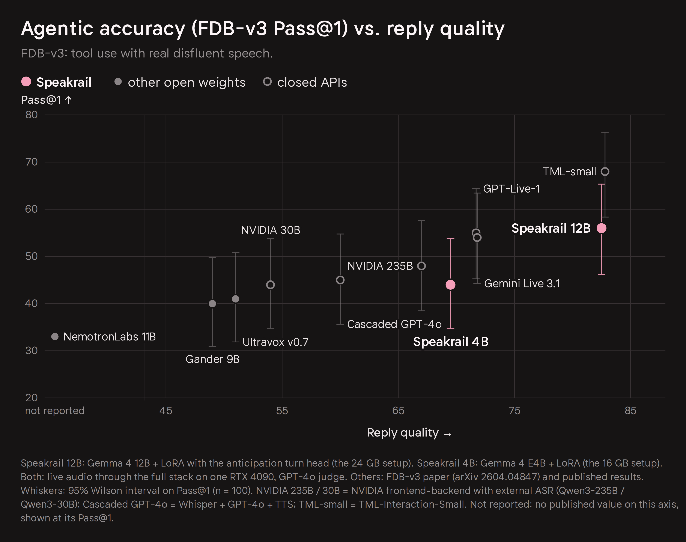
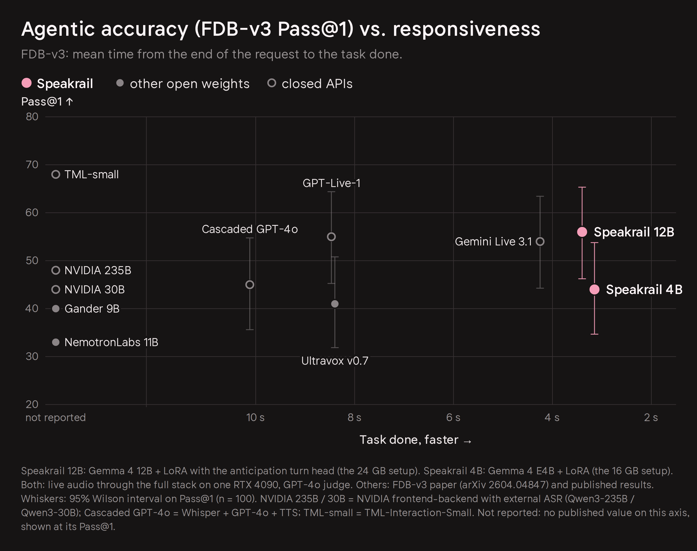
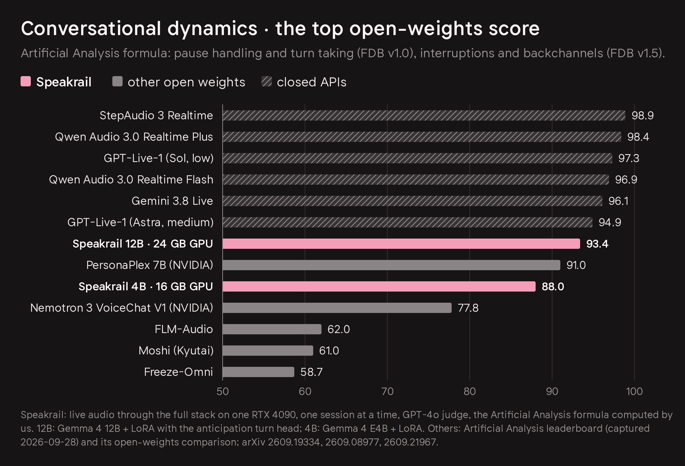

# Speakrail

A full-duplex voice assistant that runs on one NVIDIA GPU with 16 GB or more, or on an Apple Silicon Mac.

```bash
curl -fsSL https://raw.githubusercontent.com/speakrail/speakrail/main/install.sh | sh
```

The installer checks the machine and lists the setups for it, with the memory each needs; the one it recommends is preselected, and any of them can be picked. Then it downloads what that setup needs. Then `speakrail start`, and open the page it shows you.

https://github.com/user-attachments/assets/4d73f149-2d94-4bf6-b0a8-76be4b8a1840

Speakrail listens while it talks. You can interrupt it, say "mm-hmm" without stopping it, pause mid-sentence without being cut off, and ask it to count your reps while you keep talking.

## How it works

```
mic ─► Voxtral Mini 4B Realtime (audio.cpp) + turn-taking head ─► words + "is the user done?" every 80 ms
                                                                         │
              Gemma 4 12B or E4B + Speakrail LoRA ◄──────────────────────┘
                       one decision per event: speak / listen / interrupt / yield / interject
                                   │
                                   ▼
                       Breeze TTS 2 or Pocket TTS ─► speaker
```

- **Turn-taking head:** a small head on Voxtral's hidden states tells, every 80 ms, whether you're speaking, finished, pausing mid-thought, or just backchanneling, and whether you're about to finish. [Weights](https://huggingface.co/speakrail/speakrail-voxtral-realtime-2602-turnhead-2611).
- **Turn-taking LLM:** Gemma 4 with a LoRA that reads your words as they arrive and makes every turn-taking decision itself, in one token per event (~60 ms): the 12B on 24 GB GPUs ([model card](https://huggingface.co/speakrail/gemma-4-12B-it-qat-Speakrail)), E4B, which we call the 4B, on 16 GB GPUs and Macs ([model card](https://huggingface.co/speakrail/gemma-4-E4B-it-qat-Speakrail-181026)).
- **Peek and speculation:** when the head thinks you're done, the recognizer's last words are drained early and the reply starts before the turn is confirmed, so the answer is ready the moment you stop.
- **Listening notes:** while you talk, the base model takes notes on what you want, so long or corrected requests are answered correctly.
- **Tools:** weather, timers, notes, lists, calculator, unit conversion, optional web search and an optional larger model for hard questions.

## Results





### Conversational dynamics

Pause handling, turn-taking, interruptions and backchannels, scored with the Artificial Analysis formula on Full-Duplex-Bench v1.0 and v1.5: 93.4 for the 12B, the top open-weights score, and 88.0 for the 4B.



Latency on real recorded conversations, from your last word to the reply reaching your ear (median): 0.74 s on the 24 GB setup (6 recordings, 66 replies) and 0.54 s on the 16 GB setup (2 recordings, 12 replies), both on an RTX 4090. Every setup's numbers are in [configs/](configs/README.md).

## Prerequisites

- **NVIDIA:** an x86_64 Linux machine, or Windows with WSL2, with a 16 GB or larger NVIDIA GPU and a recent driver; Docker with the [NVIDIA Container Toolkit](https://docs.nvidia.com/datacenter/cloud-native/container-toolkit/latest/install-guide.html). The engines run in containers, so nothing is compiled. WSL2 hasn't been tested yet.
- **Mac:** Apple Silicon with 16 GB or more, and Apple's Command Line Tools (`xcode-select --install`).
- Disk: 15-25 GB of models, and on NVIDIA about 35-50 GB of container images.

## Installation

The one-liner above is all you need; `install.sh --help` lists its options. Which setup runs where is in [configs/](configs/README.md):

| Setup                     | For                                | Voice                                                  | Context     |
| ------------------------- | ---------------------------------- | ------------------------------------------------------ | ----------- |
| `nvidia-12b-24gb`         | NVIDIA, 24 GB and up               | Breeze TTS 2 (non-commercial)                          | 16k tokens  |
| `nvidia-e4b-16gb`         | NVIDIA, 16 GB and up               | Pocket TTS                                             | 128k tokens |
| `nvidia-12b-24gb-highctx` | NVIDIA, 24 GB and up, by name only | Pocket TTS: a worse voice, for eight times the context | 128k tokens |
| `mac-e4b`                 | Apple Silicon, 16 GB and up        | Pocket TTS                                             | 16k tokens  |

The setup picked at install is the one `speakrail start` runs; `speakrail start --config NAME` runs another one once, and `speakrail install` picks again. If the recommended one was picked, every start chooses again, so a new recommended setup comes with an update. `speakrail config` shows what it would run here and why. The first start measures the machine, a minute or two. `speakrail status`, `speakrail logs` and `speakrail stop` do what they say, and `speakrail doctor` checks the installation.

The container images come from Docker Hub: [speakrail/audiocpp-server](https://hub.docker.com/r/speakrail/audiocpp-server) (speech recognition and Pocket), [speakrail/breeze-tts-server](https://hub.docker.com/r/speakrail/breeze-tts-server) and [speakrail/vllm-openai](https://hub.docker.com/r/speakrail/vllm-openai) (vLLM 0.26 with a patch for Gemma 4's per-layer embeddings). Their Dockerfiles are in [engines/](engines/README.md).

Browsers allow the microphone only on `localhost` or over HTTPS. If Speakrail runs on another machine, use an SSH tunnel:

```bash
ssh -L 8080:localhost:8080 your-gpu-box
```

`http://localhost:8080/debug/` shows what the system sees and decides: turn-head probabilities, every decision, per-turn latencies.

## Troubleshooting

**`speakrail start` stops right away:** `speakrail doctor` says what is missing, with the command that fixes it. `speakrail logs` shows the service's log, and `speakrail logs asr-audiocpp-docker` (or another engine) one engine's.

**The UI doesn't open:** the port is probably taken by another program. Pick a free one: `UI_PORT=8085 speakrail start`.

## Updating and uninstalling

```bash
speakrail update          # the newest version; it stops Speakrail first, and says which models changed
speakrail rollback        # back to the version before the last update
speakrail uninstall       # asks first; --keep-models leaves the models where they are
```

`speakrail status` says when a newer version is out; it asks GitHub at most once a day, and `SPEAKRAIL_UPDATE_CHECK=0` turns that off. `~/.speakrail/state.json` records what is installed: the commit of the code, the setup, and the repository and commit every model file came from. An update keeps the files and images the version before it used, so a rollback only downloads what the update replaced in place, and removes what neither of the two uses. It only ever removes files it downloaded itself.

## Using it from your own app

Speakrail serves OpenAI's GPT-Live protocol on a WebSocket, `ws://127.0.0.1:8080/v1/live/sessions`, with the token from `~/.speakrail/config/api_token`. [examples/gpt_live_client.py](examples/gpt_live_client.py) is a complete client in one file: it streams audio in, prints both sides of the conversation, answers a tool call of its own, and saves the reply. With Speakrail running:

```bash
python examples/gpt_live_client.py --wav question.wav --out answer.wav
```

Turn-taking is Speakrail's own, so there is no turn detection to configure. `src/speakrail/gateway/live.py` lists what the protocol supports so far.

## Adding your own

Engines and setups are files: [Adding an engine](docs/adding-an-engine.md) and [Adding a config](docs/adding-a-config.md) walk through both. `speakrail verify` starts a setup, plays five synthetic test conversations through it, and writes a report with this machine's details; `speakrail verify --quick` plays one, to check an install.

## Configuration

Settings come from environment variables, or from `--set key=value` on `speakrail start`:

| Setting                       | Default              |                                                                                                                       |
| ----------------------------- | -------------------- | --------------------------------------------------------------------------------------------------------------------- |
| `UI_HOST` / `UI_PORT`         | `127.0.0.1` / `8080` | where the web UI listens                                                                                              |
| `VOICE`                       | the setup's          | a Pocket voice name, or for Breeze a reference clip in `src/speakrail/harness/voices/` with its transcript next to it |
| `HOME_CITY` / `HOME_TIMEZONE` | London               | "home" for the weather and time tools                                                                                 |
| `SILENCE_MS`                  | `1000`               | silence that ends your turn when the head is unsure                                                                   |
| `NOTES`                       | the setup's          | listening notes (better answers to long requests)                                                                     |
| `SEARCH`                      | `off`                | `serper` or `brave` (API key), or `searxng` with your own SearXNG at `SEARXNG_URL`                                    |
| `FIREWORKS_API_KEY`           | empty                | enables asking a larger model for hard questions (paid)                                                               |
| `SESSIONS_DIR`                | off                  | save every session (log, context, audio) for debugging                                                                |

## Limitations

- English only.
- One conversation at a time.
- Echo cancellation comes from the client: browsers do it; a bare microphone and speaker on a device without it will hear the assistant as you.
- Following written-format instructions (word counts, markdown) is weaker than base Gemma: the model is tuned for short spoken answers.
- Breeze TTS 2, the voice of the 24 GB setup, is for research and non-commercial use only; see the license below. The other setups use Pocket TTS.

## License

Speakrail's code is licensed under the [Apache License 2.0](LICENSE).

The models it downloads keep their own licenses (details in [NOTICE](NOTICE)):

- **Gemma 4 12B and E4B** (Google DeepMind): Apache 2.0
- **Voxtral Mini 4B Realtime** (Mistral AI): Apache 2.0
- **Pocket TTS** (Kyutai): CC-BY-4.0; its terms prohibit illegal, harmful or deceptive use, including cloning a voice without explicit and lawful consent
- **Breeze TTS 2** (BreezeBlue): code Apache 2.0; model weights and the audio they generate are for research and non-commercial use only. If you want to use speakrail commercially, you will have to swap that for another TTS. Any streaming TTS should work (in theory).

Speech recognition runs on [our fork of audio.cpp](https://github.com/speakrail/audio.cpp) (Apache 2.0, by [ShugoAI LLC](https://github.com/0xShug0/audio.cpp)), which adds the turn-taking head and peek decoding to its Voxtral realtime model. The voice runs on [our fork of Breeze TTS](https://github.com/speakrail/breeze-tts), which adds int8 serving next to an LLM on one card.
